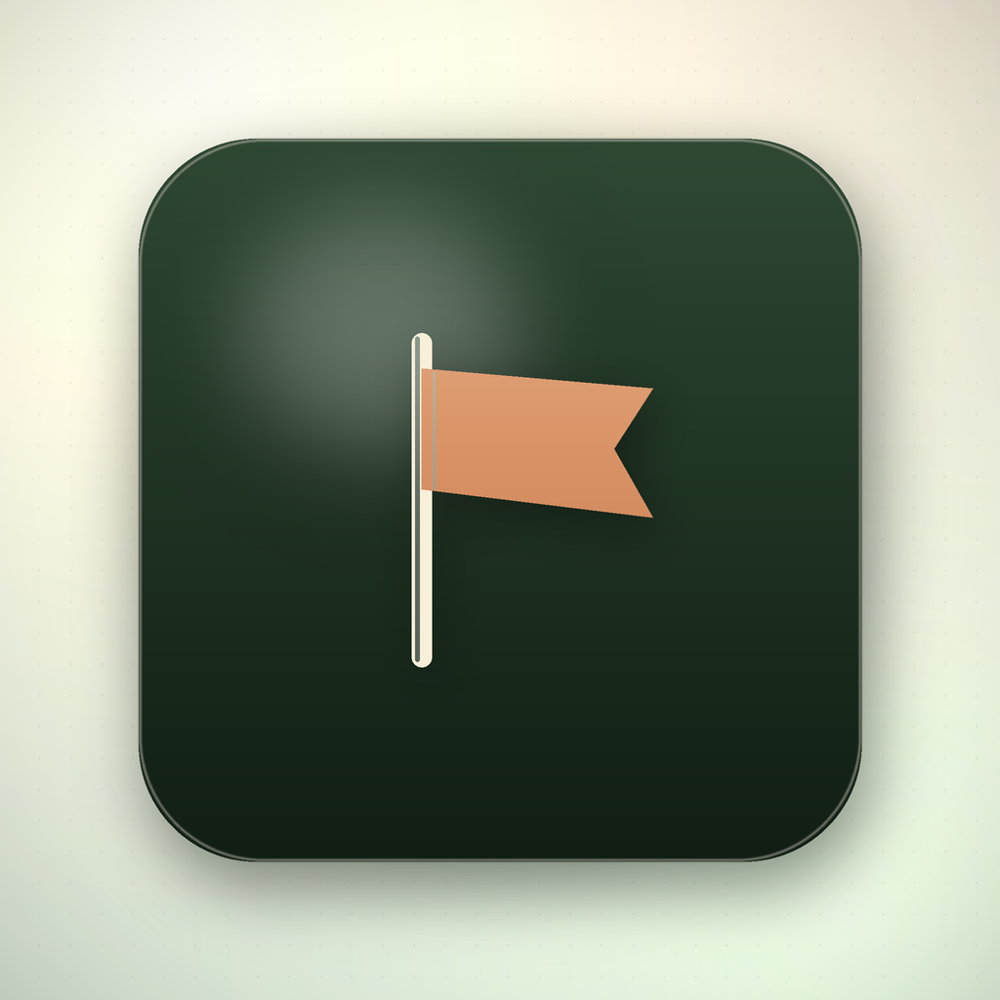
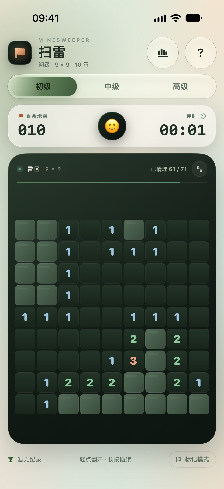
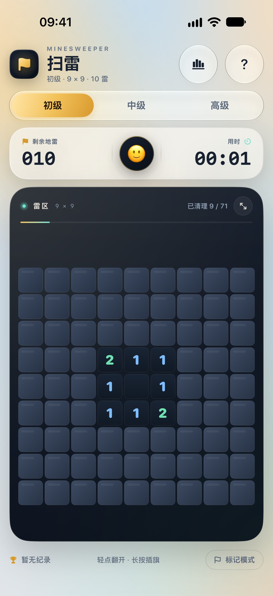
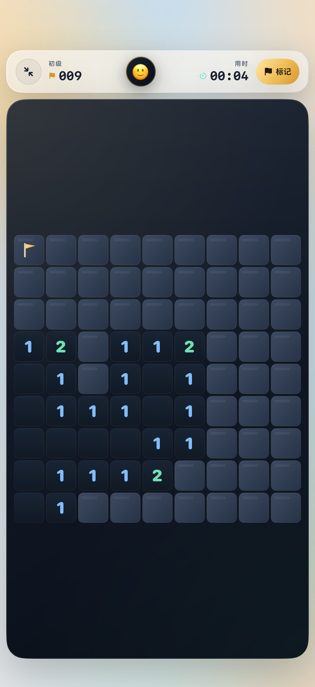
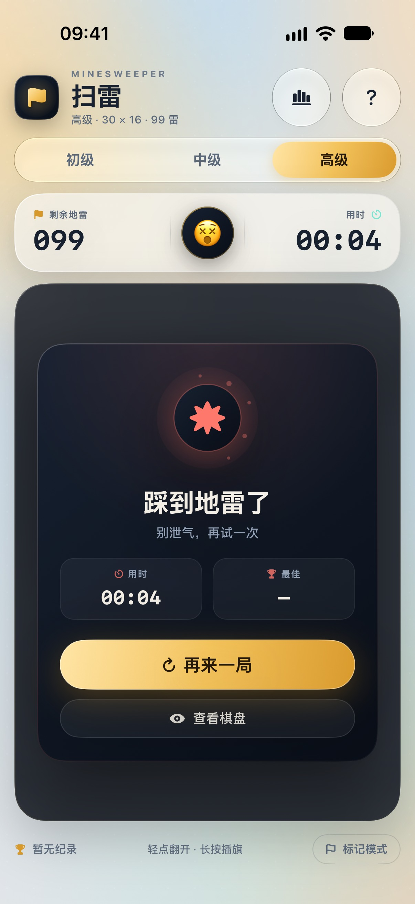
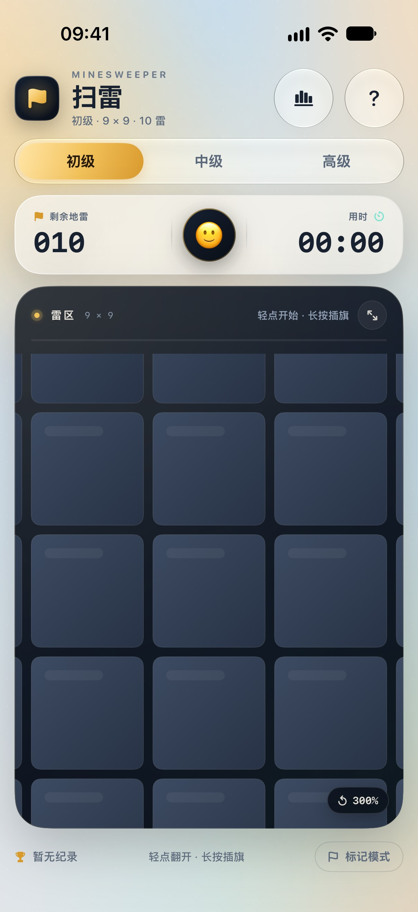
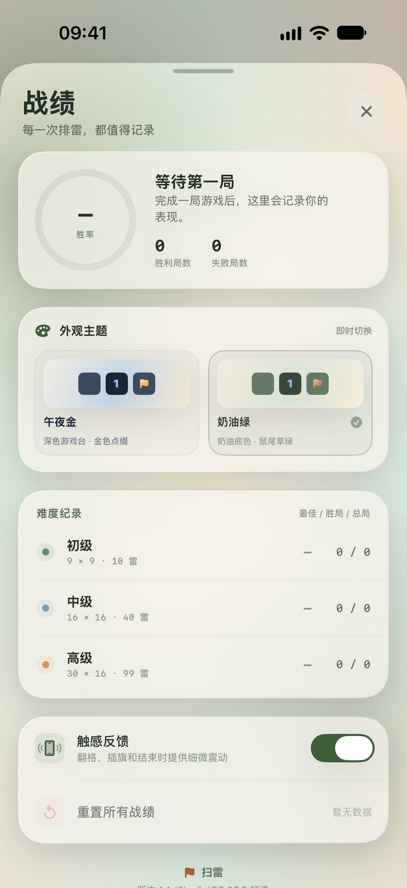
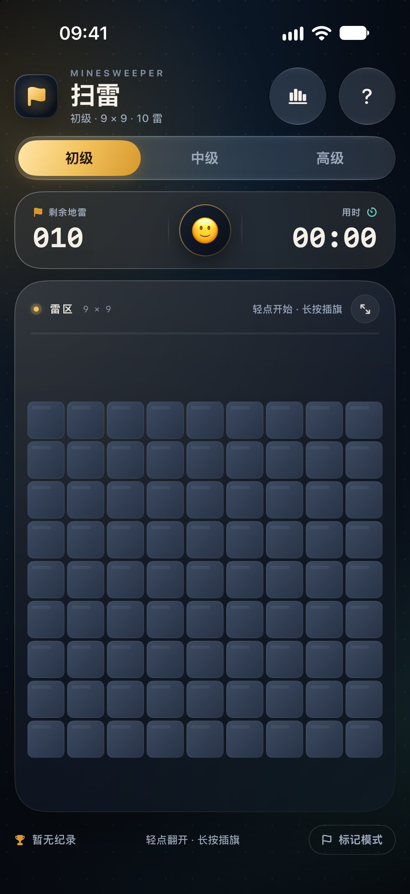

# 扫雷 · Minesweeper

一款用 SwiftUI 从零实现的现代扫雷游戏。基于 **iOS 27.2 SDK** 构建，支持 Liquid Glass、深色/浅色外观、iPhone 横竖屏、iPad，以及两套可即时切换的主题。





## 特性

- **经典规则**：初级 9×9 / 10 雷、中级 16×16 / 40 雷、高级 30×16 / 99 雷。
- **首次点击安全**：第一下点击及其周围八格不会布雷，开局更从容。
- **完整操作**：轻点翻格、长按插旗、数字和弦、标记模式，以及点按已插旗格取消标记。
- **双指缩放**：任意棋盘都可以双指捏合放大（1×–3×），单指拖动查看，右下角会显示缩放比例并可一键恢复。
- **横屏模式**：iPhone 旋转到横屏后切换为侧栏布局；iPad 横竖屏均自适应。
- **全屏专注**：点击棋盘右上角的展开按钮进入全屏，保留紧凑的雷数、计时、重开与标记控制。
- **两套主题**：在「战绩 → 外观主题」中即时刻切换「午夜金」和「奶油绿」，选择会被保存。
- **流畅反馈**：翻格、插旗、触雷、胜利都有触感反馈，可在战绩页关闭。
- **计时与纪录**：独立保存每个难度的最佳时间、胜局与总局数。
- **iOS 27 风格图标**：奶油底、玻璃绿色方块与插旗标志，包含深色和着色图标变体。
- **无障碍**：每个方格都有 VoiceOver 标签、状态值与翻格 / 插旗操作，结果页会接管辅助功能焦点。
- **隐私友好**：无网络请求、无追踪、无第三方依赖，包含 `PrivacyInfo.xcprivacy`。

## 截图

| 经典对局 | 全屏模式 |
| --- | --- |
|  |  |

| 触雷结算 | 双指缩放 |
| --- | --- |
|  |  |

| 奶油绿主题 | 奶油绿战绩 |
| --- | --- |
|  |  |

| 玩法说明 | 深色模式 |
| --- | --- |
|  |  |

| 高级棋盘 | iPad |
| --- | --- |
|  |  |

更多：[插旗状态](Screenshots/iphone-flagged.jpg) · [触雷后的棋盘](Screenshots/iphone-after-loss.jpg) · [完整战绩](Screenshots/iphone-stats.jpg) · [浅色模式](Screenshots/iphone-light.jpg)

## 交互说明

| 操作 | 翻开模式（默认） | 标记模式 |
| --- | --- | --- |
| 轻点未翻开格 | 翻开 | 插旗 |
| 长按未翻开格 | 插旗 | 翻开 |
| 轻点已插旗格 | 取消旗子 | 取消旗子 |
| 轻点已翻开的数字 | 当周围旗数等于数字时，翻开周围格子 | 同左 |

- **缩放**：在棋盘区域双指捏合；缩放后单指拖动查看，右下角的百分比按钮可恢复适应大小。
- **全屏**：棋盘标题栏右上角的展开按钮进入全屏；全屏顶栏左上角按钮退出。
- **横屏**：iPhone 横屏后会在左侧显示难度、计时、标记和入口；可随时旋转回竖屏。
- **主题**：打开「战绩」，在「外观主题」中选择「午夜金」或「奶油绿」。

## 运行

环境要求：

- Xcode **27.2**（包含 iOS 27.2 SDK）
- 最低部署版本：iOS **27.0**

打开 `Minesweeper.xcodeproj`，选择任意 iPhone / iPad 模拟器运行。真机运行需在 target 的 Signing & Capabilities 中选择开发团队。

```bash
xcodebuild \
  -project Minesweeper.xcodeproj \
  -scheme Minesweeper \
  -destination 'platform=iOS Simulator,name=iPhone 18 Pro' \
  build
```

项目由 [XcodeGen](https://github.com/yonaskolb/XcodeGen) 管理；修改 `project.yml` 后可重新生成工程：

```bash
xcodegen generate
```

## 测试

```bash
xcodebuild \
  -project Minesweeper.xcodeproj \
  -scheme Minesweeper \
  -destination 'platform=iOS Simulator,name=iPhone 18 Pro' \
  test
```

- **15 个单元测试**覆盖布雷安全区、洪水翻开、胜负判定、和弦、旗子上限、计时、战绩持久化等。
- **9 个 UI 测试**覆盖开局、标记模式、长按插旗、高级棋盘滚动、双指缩放、全屏、主题切换、触雷结算、战绩与玩法页，以及 iPhone / iPad 横屏布局。
- 当前代码在 iOS 27.0（iPhone 18 Pro）模拟器上全量测试通过；iPad 上的主题、全屏与横屏测试通过。
- 已在 **iPhone 15（iOS 27.2 真机）** 上安装并启动版本 1.1。
- 工程使用 Xcode 27.2 的 iOS 27.2 SDK 编译。当前机器没有 iOS 27.2 模拟器运行时，27.2 以真机验证为准；签名团队未写入工程文件。

## 代码结构

```text
Minesweeper/
├── App/                 # App 入口
├── Game/                # 纯规则、游戏流程、难度、战绩模型
│   ├── MinesweeperGame.swift
│   ├── GameModel.swift
│   ├── MinePlacer.swift
│   └── PlayerStats.swift
├── Design/              # 调色板、主题、背景、通用组件
├── Views/
│   ├── BoardCanvas.swift          # 单遍 Canvas 棋盘绘制
│   ├── BoardInteractionLayer.swift# 整个棋盘共用的 UIKit 手势层
│   ├── BoardAccessibilityGrid.swift
│   ├── BoardView.swift
│   ├── GameScreen.swift
│   ├── FullScreenHUD.swift
│   ├── LandscapeSidebar.swift
│   └── ...
├── Support/             # 触感反馈与时间格式化
└── Assets.xcassets      # App 图标、强调色、启动背景
```

核心规则集中在 `MinesweeperGame`，通过注入的 `MinePlacer` 支持确定性单元测试；`GameModel` 负责难度、主题、统计与 `UserDefaults` 持久化。界面层只消费状态。

## 性能说明

中、高级棋盘的渲染与触控经过专门重构：

- **单 Canvas 绘制**：整个棋盘背景、数字、旗子和地雷由一次 Canvas 绘制完成，不再为每个格子构建渐变、文字和阴影视图。
- **单手势层**：整个棋盘只有一个透明 UIKit 层处理轻点和长按，避免数百个手势识别器参与命中测试。
- **轻量辅助层**：VoiceOver 使用无绘制的透明辅助网格；视觉层不再承担字号、阴影和滤镜的合成。
- **缩放分两阶段**：捏合时只做一次轻量预览变换，松手后才以新的矢量尺寸重建棋盘，避免连续重排 480 个格子。

这些改动针对首击大范围翻开和中级/高级棋盘滚动做了优化。

## 设计备注

- 两套主题：**午夜金**保留最初的夜间游戏台与金色点缀；**奶油绿**采用奶油底、鼠尾草绿棋盘与陶土色旗帜。
- 深色/浅色外观均由当前调色板适配，主题在统计页即时生效。
- iPhone 支持竖屏与横屏；iPad 支持横竖屏及窗口化尺寸。
- 应用采用纯 SwiftUI + Observation，无外部框架；使用 Canvas 与 UIKit 手势桥接完成高性能棋盘交互。
