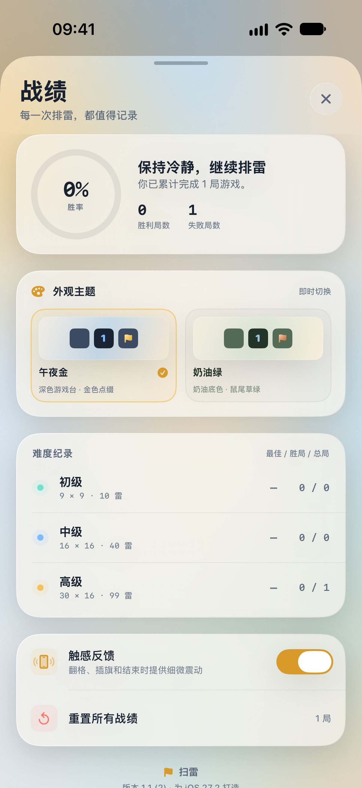
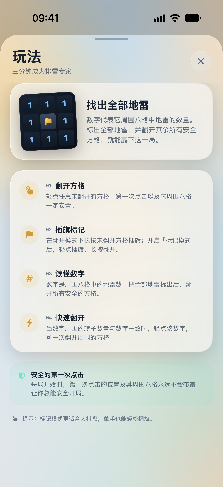
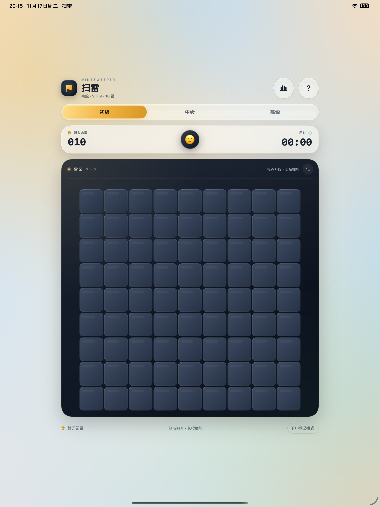
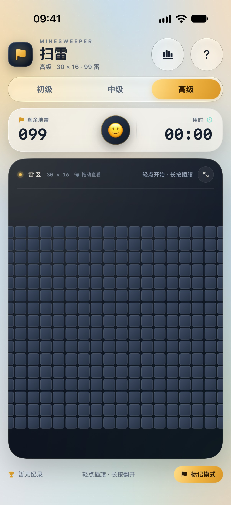

# 扫雷 · Minesweeper

一款用 SwiftUI 从零实现的现代扫雷游戏。项目基于 **iOS 27.2 SDK** 构建，使用 Liquid Glass 风格控件，同时适配 iPhone 与 iPad、浅色与深色外观。


## 特性

- **经典规则**：初级 9×9 / 10 雷、中级 16×16 / 40 雷、高级 30×16 / 99 雷。
- **首次点击安全**：第一下点击及其周围八格不会布雷，开局更从容。
- **完整操作**：轻点翻格、长按插旗、数字和弦、标记模式，以及点按已插旗格取消标记。
- **流畅反馈**：翻格、插旗、触雷、胜利都有触感反馈，可在战绩页关闭。
- **计时与纪录**：独立保存每个难度的最佳时间、胜局与总局数。
- **全屏模式**：点击棋盘右上角的展开按钮进入沉浸式棋盘，保留雷数、计时、重开和标记模式；再点左上角按钮退出。
- **自适应布局**：iPhone 单列布局，iPad 居中游戏台布局；高级棋盘支持拖动查看。
- **大棋盘优化**：中级/高级棋盘使用单一触控手势层与合批渲染，减少大量独立控件带来的滚动和点击卡顿。
- **Liquid Glass 与氛围视觉**：系统玻璃材质、渐变雷区面板、柔和光晕和深色夜间主题。
- **无障碍**：每个方格都有 VoiceOver 标签、状态值与翻格 / 插旗操作，结果页会接管辅助功能焦点。
- **隐私友好**：无网络请求、无追踪、无第三方依赖，包含 `PrivacyInfo.xcprivacy`。

## 截图

| 对局 | 触雷结算 |
| --- | --- |
|  |  |

| 战绩 | 玩法 |
| --- | --- |
|  |  |

| 深色模式 | iPad |
| --- | --- |
|  |  |

| 全屏模式 | 高级棋盘 |
| --- | --- |
|  |  |

更多截图：[浅色模式](Screenshots/iphone-light.jpg)

## 交互说明

| 操作 | 翻开模式（默认） | 标记模式 |
| --- | --- | --- |
| 轻点未翻开格 | 翻开 | 插旗 |
| 长按未翻开格 | 插旗 | 翻开 |
| 轻点已插旗格 | 取消旗子 | 取消旗子 |
| 轻点已翻开的数字 | 当周围旗数等于数字时，翻开周围格子 | 同左 |

底部「标记模式」可以随时切换，适合单手操作或大棋盘。全屏模式下同样保留了一个紧凑的标记按钮。

## 运行

环境要求：

- Xcode **27.2**（包含 iOS 27.2 SDK）
- 最低部署版本：iOS **27.0**

打开 `Minesweeper.xcodeproj`，选择任意 iPhone / iPad 模拟器运行即可。若要在真机运行，请先在 target 的 Signing & Capabilities 中选择开发团队。

也可以使用命令行构建：

```bash
xcodebuild \
  -project Minesweeper.xcodeproj \
  -scheme Minesweeper \
  -destination 'platform=iOS Simulator,name=iPhone 18 Pro' \
  build
```

项目由 [XcodeGen](https://github.com/yonaskolb/XcodeGen) 管理；修改 `project.yml` 后可重新生成工程：

```bash
xcodegen generate
```

## 测试

```bash
xcodebuild \
  -project Minesweeper.xcodeproj \
  -scheme Minesweeper \
  -destination 'platform=iOS Simulator,name=iPhone 18 Pro' \
  test
```

- **15 个单元测试**覆盖布雷安全区、洪水翻开、胜负判定、和弦、旗子上限、计时、战绩持久化等。
- **6 个 UI 测试**覆盖开局、标记模式、长按插旗、高级棋盘滚动、全屏模式、触雷结算、战绩与玩法页。
- 已在 iOS 27.0（iPhone 18 Pro）和 iOS 27.1（iPhone Duo）模拟器上全量通过；iPad 布局与全屏模式在 iPad Pro 13-inch (M5) 模拟器上验证。
- 已在 **iPhone 15（iOS 27.2 真机）** 上使用 Apple Development 签名完成安装并成功启动。
- 工程使用 Xcode 27.2 的 iOS 27.2 SDK 编译；本机未安装 iOS 27.2 模拟器运行时，真机 27.2 验证以实际设备为准。签名团队未写入工程文件，换机或换团队时在 Xcode 中选择即可。

## 代码结构

```text
Minesweeper/
├── App/                 # App 入口
├── Game/                # 纯游戏规则、游戏流程、难度、战绩模型
│   ├── MinesweeperGame.swift
│   ├── GameModel.swift
│   ├── MinePlacer.swift
│   └── PlayerStats.swift
├── Design/              # 主题、背景、通用组件
├── Views/               # 游戏界面、棋盘、HUD、结果显示、战绩与玩法页
├── Support/             # 触感反馈与时间格式化
└── Assets.xcassets      # App 图标、强调色、启动背景
```

核心规则集中在 `MinesweeperGame`，通过注入的 `MinePlacer` 支持确定性单元测试；`GameModel` 负责难度切换、统计记录与 `UserDefaults` 持久化。界面层只消费状态，不包含游戏规则。

## 大棋盘性能

中高级棋盘曾因每个格子都带独立手势和阴影/模糊图层而出现卡顿。现在采用：

- **单手势层**：整个棋盘只有一个透明 `UIViewRepresentable` 处理轻点与长按，避免 256~480 个手势识别器相互竞争。
- **合批绘制**：使用 `drawingGroup()` 将图块绘制合并为一张图层，滚动时不再合成数百个独立图层。
- **轻量图块**：中级/高级的小尺寸图块跳过阴影、模糊和部分高光叠层，仅保留清晰的填色、数字和旗标。
- **控件分离刷新**：计时器与棋盘状态各自更新，减少无关视图重建。

## 设计备注

- 棋盘在浅色和深色下都保持深色游戏台，让数字和旗子的颜色保持一致、清晰。
- 首击安全区、和弦、自动补旗等规则均由单元测试固定。
- 应用采用纯 SwiftUI + Observation，无外部框架；最低 iOS 27.0，以使用 Liquid Glass API 并保持较广的兼容范围。
- iPhone 锁定竖屏体验，iPad 支持横竖屏及窗口化尺寸；iPad 界面会收束棋盘宽度，避免大屏上出现过大的空旷游戏台。
